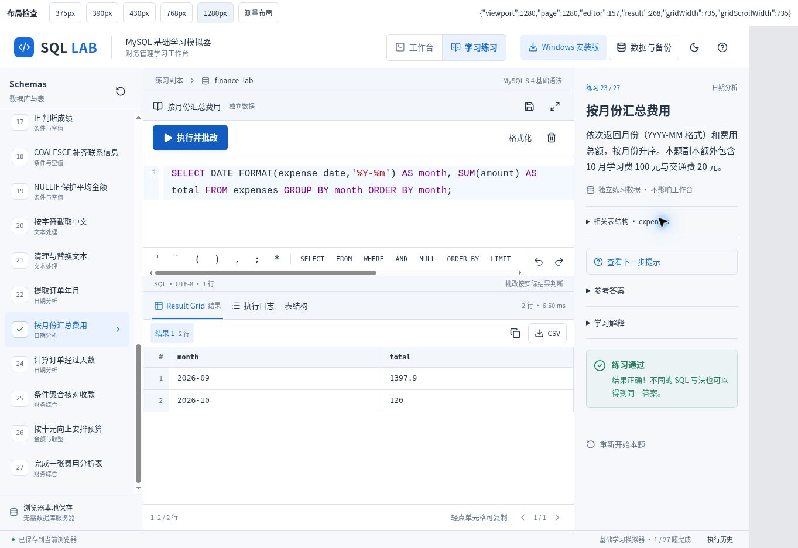

<p align="center">
  
</p>

# SQL LAB

> **1.0.2**：恢复 SQL 自动与上下文补全，显示 SVG 候选图标、主键标记及字段类型。[补全操作](docs/sql-completion.md)。手机同屏练习与原生框选保留。[练习更新](docs/learning-1.0.md) · [更新与部署](docs/updates.md)。

**面向零基础与财务管理学习者的中文 MySQL 基础练习工作台。**

在手机上写 SQL、查看结果、完成练习；也可以安装 Windows 离线版。数据库、草稿和学习进度保存在本地，执行与批改无需外部数据库服务器或 AI API。

[](https://github.com/MarikoAkina/sql-lab/actions/workflows/ci.yml)
[](https://github.com/MarikoAkina/sql-lab/actions/workflows/windows.yml)
[版本与安装包](https://github.com/MarikoAkina/sql-lab/releases/latest) · [MIT License](LICENSE)

**[在线体验](https://akinaly.top/sql-lab/)** · **[下载 Windows 安装版](https://github.com/MarikoAkina/sql-lab/releases/latest)** · **[阅读新手指南](docs/getting-started.md)** · **[打开文档目录](docs/README.md)**

> SQL LAB 是基础学习模拟器，兼容目标为 MySQL 8.4 的部分基础语法。字符串比较、类型转换、分组与自增等行为仍有差异，详见 [SQL 支持范围与兼容限制](docs/sql-compatibility.md)。

## 页面导航

- [开始使用](#开始使用)
- [界面预览](#界面预览)
- [第一条 SQL](#第一条-sql)
- [功能概览](#功能概览)
- [学习路线](#学习路线)
- [文档目录](#文档目录)
- [源码目录](#源码目录)
- [验证状态](#验证状态)
- [参与项目](#参与项目)

## 开始使用

| 使用方式 | 入口 | 说明 |
| --- | --- | --- |
| Windows 安装版 | [下载最新发布版本](https://github.com/MarikoAkina/sql-lab/releases/latest) | Windows 10 / 11 x64；安装后可离线练习，无需 Node.js、MySQL 或账号 |
| 手机与电脑网页 | [打开公开体验网页](https://akinaly.top/sql-lab/) | 无需注册应用账号；练习记录保存在当前浏览器，也可自行部署 |

当前源码版本为 **1.0.2**，Windows 安装包由发布流程验证后提供。下载 `SQL-Lab-Setup-1.0.2.exe`，按向导安装并打开 SQL LAB。安装包暂未使用发布者证书，Windows 可能显示“未知发布者”；[发布页](https://github.com/MarikoAkina/sql-lab/releases/tag/v1.0.2)提供 SHA256 校验文件与安装检查报告。

网页已开放为公开试用。数据仍分别保存在各自浏览器，不会自动跨设备同步。自行部署和本地运行见 [开发指南](docs/development.md)。

0.3.1 及以前需先手动安装一次 1.0.2；以后可用顶部或帮助菜单“检查更新”。AWS 试用站的部署命令见 [更新与部署指南](docs/updates.md)。 现提供服务器自动更新器，一次安装后每约 10 分钟校验并部署 GitHub 新版；网页按钮加载已部署的版本。[安装自动更新器](docs/updates.md#让试用站以后自动部署新版推荐)。

## 界面预览



*恢复原版布局、调整模式切换栏后的真实 Chromium 截图。客户与邮箱均为虚构教学数据；手机与平板截图见验收说明。*

## 第一条 SQL

首次打开时，工作台已选择财务示例库 `finance_lab`。在编辑器输入下面的语句，点击 **执行 SQL**：

```sql
SELECT * FROM customers;
```

初始数据会返回 5 位客户。接着只查看武汉客户的姓名和城市：

```sql
SELECT name, city
FROM customers
WHERE city = '武汉';
```

初始数据会返回 3 行。`SELECT` 选择要看的列，`FROM` 指定表，`WHERE` 筛选记录。查询不会修改数据；以上行数以尚未修改的示例库为准。

切换到 **学习练习**，从第 1 题开始。手机可在底部“题目”查看示例与预期结果，再点“编写 SQL”。每题都有目标、示例表数据、表结构、预期结果、分步提示和折叠的参考答案，点击 **执行并批改** 检查结果。[继续阅读新手指南 →](docs/getting-started.md)

## 功能概览

| 能力 | 当前实现 |
| --- | --- |
| 数据库工作台 | Schemas 树、字段类型与主键标记、表数据与结构浏览、多标签 SQL 编辑器 |
| 编辑与执行 | 行号、高亮、自动与上下文补全、主键图标、格式化；执行选中内容、当前语句或全部语句；多结果集与执行日志 |
| 手机操作 | 数据库（学习时为练习目录）／编辑器／结果／历史导航，全屏编辑、SQL 符号与关键词辅助栏，结果区域横向滚动 |
| 基础 SQL | 建库建表、修改表、增删改、筛选与分页、聚合分组、两表连接和基础非关联子查询 |
| 函数与表达式 | CASE、条件与空值函数、中文文本处理、日期分析与金额取整；[扩展指南](docs/expansion-1.md) |
| 财务示例 | 客户、订单、费用与预算练习；金额使用十进制计算，保留 NULL、重复值和未匹配记录 |
| 学习与批改 | 45 道渐进练习；查询比较实际结果，写入练习检查独立数据副本的最终状态 |
| 保存与迁移 | IndexedDB 自动保存、完整 JSON 备份与恢复、SQL 脚本导入导出、结果复制与 CSV 导出 |
| Windows 离线版 | 与网页共用前端和 SQL 引擎，提供安装程序、原生菜单、本地保存与手动触发的自动更新 |

SQL 使用 **node-sql-parser 的 MySQL AST 与自有结构化执行器**，金额使用 **decimal.js**，执行任务放在 **Web Worker** 中。支持语法、行为差异与容量上限集中说明在 [兼容文档](docs/sql-compatibility.md)。

## 学习路线

| 阶段 | 练习 | 目标 |
| --- | --- | --- |
| 读取数据 | 1–2 | 全表查询与选择列 |
| 筛选与排序 | 3–6 | 条件、金额区间、排序、分页、去重与 NULL |
| 统计分析 | 7–9 | COUNT、金额汇总、GROUP BY 与 HAVING |
| 多表查询 | 10–11 | LEFT JOIN 与基础子查询 |
| 修改数据 | 12–14 | INSERT、UPDATE、DELETE 与影响范围 |
| 数据库设计 | 15 | 主键、字段类型、非空约束、默认值与预算表 |
| 条件与文本 | 16–21 | CASE、IF、COALESCE、NULLIF、中文截取与文本清理 |
| 日期分析 | 22–24 | 年月季度、按月费用汇总、日期差 |
| 财务综合 | 25–27 | 条件聚合、向上安排预算与费用分析表 |
| 条件与分页巩固 | 28–33 | IN、LIKE、括号、分页、含税金额与筛选后分组 |
| 客户收款分析 | 34–39 | 连接匹配、ON 与 WHERE、子查询、客户收款、NULL 与空文本 |
| 数据维护与设计 | 40–45 | 多行插入、条件更新删除、ALTER、建表与收款计划 |

练习统一列出 01–45 题，按查询、统计、表设计、条件、文本、日期和财务分析的顺序学习。原有题号、通过记录与备份保持兼容；第 23、27 题只在独立题目副本增加跨月费用，不修改工作台。

示例库包含 `finance_lab`（客户、订单、费用）和 `campus_lab`（学生成绩）。工作台修改会自动保存；学习练习使用独立数据，支持重新开始。

## 文档目录

| 文档 | 解决的问题 |
| --- | --- |
| [新手与手机指南](docs/getting-started.md) | 如何写第一条 SQL、操作结果表、使用练习和手机输入辅助 |
| [数据、备份与恢复](docs/data-and-backup.md) | 数据保存在哪里，如何迁移、导入脚本和恢复示例库 |
| [SQL 支持范围与兼容限制](docs/sql-compatibility.md) | 哪些语法能用，与 MySQL 的行为有哪些差异 |
| [开发、构建与部署](docs/development.md) | 如何运行源码、构建网页、开发和打包 Windows 版 |
| [条件、文本与日期指南](docs/expansion-1.md) | 新增函数、12 道进阶题和可直接执行的财务示例 |
| [测试与验收](docs/testing.md) | 自动化检查覆盖什么，哪些实机验证仍未完成 |
| [贡献指南](CONTRIBUTING.md) | 如何反馈问题、补充练习和提交修改 |

## 源码目录

| 路径 | 用途 |
| --- | --- |
| [docs/](docs/README.md) | 分主题使用与开发文档 |
| [app/](app/) | 工作台页面与响应式样式 |
| [components/](components/) | SQL 编辑器、帮助面板、下载入口与 UI 组件 |
| [lib/sql/](lib/sql/) | 词法处理、SQL 执行器、示例数据、练习与 Worker |
| [lib/storage.mjs](lib/storage.mjs)、[lib/worker-client.mjs](lib/worker-client.mjs) | 本地保存、备份与异步任务通信 |
| [desktop/](desktop/) | Electron 主进程、本地协议、图标与安装后操作检查 |
| [tests/](tests/) | SQL、存储、界面与桌面协议检查 |
| [public/](public/) | 移动端图标、manifest 与测试报告 |
| [.github/workflows/](.github/workflows/) | 持续检查与 Windows 安装包发布 |

代码入口与各模块之间的关系见 [开发指南](docs/development.md#代码入口)。

## 验证状态

1.0.2 手机上下同屏、面板调节与详细讲解见 [新版使用说明](docs/learning-1.0.md)。原 45 题答案、ID 与判题规则保留。


**1.0.2 源码验收：209 项自动化检查通过，0 项失败。** Windows 安装检查由发布工作流单独执行，结果见发布报告。

历史 0.4.0 已完成真实 Windows **0.3.3 → 0.4.0** 自动升级验收，**8 项全部通过**。确认下载、安装、自动重启及客户数据、脚本、练习进度恢复；新版 45 题及独立示例/预期输出正常。[0.4.0 升级报告](public/windows-upgrade-acceptance-0.4.json) · [工作流](https://github.com/MarikoAkina/sql-lab/actions/runs/40265313715)。

已补齐公开版本 **0.3.2 → 0.3.3** 的 Windows CI 自动升级验收，**7 项通过**：使用真实安装包和 GitHub 更新源，点击应用内按钮，确认自动下载安装与重新启动，并恢复客户数据、SQL 草稿和练习进度。[升级报告](public/windows-upgrade-acceptance.json) · [工作流记录](https://github.com/MarikoAkina/sql-lab/actions/runs/40260121753)。

查看 [仓库测试报告](public/test-report.json)、[Windows 发布报告](https://github.com/MarikoAkina/sql-lab/releases/download/v1.0.2/desktop-smoke.json)和 [GitHub Actions](https://github.com/MarikoAkina/sql-lab/actions)。测试组成、检查命令和报告边界见 [测试与验收](docs/testing.md)。

尚未完成真实 MySQL 8.4 服务器逐条对照，以及真实 iPhone Safari、虚拟键盘与触控流程验收。本轮 Chromium 五种宽度及 300px 可视高度的键盘模拟检查见 [练习更新记录](docs/learning-0.4.md)；模拟检查不等同于 Safari 实机验证。

## 参与项目

[首轮试用与宣传素材](docs/promotion/README.md)包含分享封面、体验卡片、SQL 实操教程和可转发短文。

欢迎反馈最小可复现的 SQL 问题、改进中文讲解、补充财务练习或完善手机交互。请先阅读 [贡献指南](CONTRIBUTING.md)，再 [报告问题或提出建议](https://github.com/MarikoAkina/sql-lab/issues/new/choose)。

项目采用 [MIT License](LICENSE)。第三方软件沿用各自许可证，详见 [THIRD_PARTY_NOTICES.md](THIRD_PARTY_NOTICES.md)。
